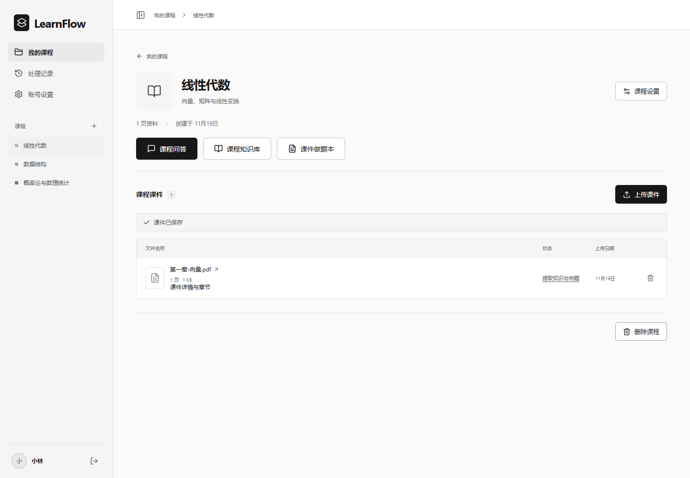
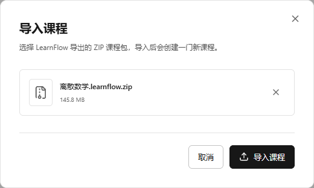
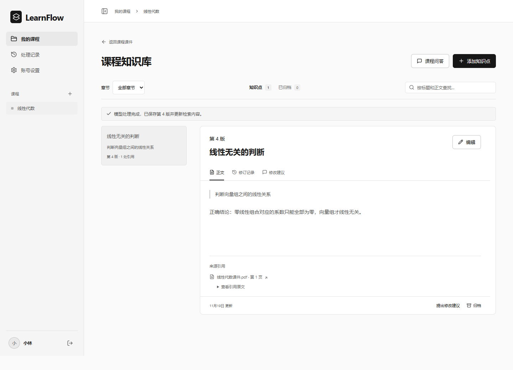
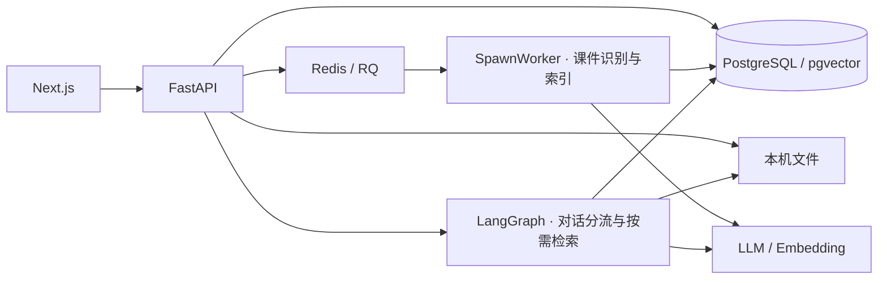

<div align="center">

# LearnFlow

课程资料、带引用的问答与原题做题本

[](https://github.com/shuimqy/LearnFlow/actions/workflows/ci.yml)
[](https://github.com/shuimqy/LearnFlow/releases/latest)
[](#快速开始)
[](.python-version)
[](https://docs.astral.sh/uv/)

[快速开始](#快速开始) · [功能](#功能) · [架构](#架构) · [开发与文档](#开发与文档)

</div>

LearnFlow 是一个 Agent + 后端实践项目，想解决大学生用网页端对话模型学习时遇到的几个问题。课件要反复上传，答案难找回原页，追问一个细节又容易打断主线。LearnFlow 把 PDF、知识点、原题和问答按课程放在一起。欢迎提交使用反馈或 Pull Request。 [GitHub Issues](https://github.com/shuimqy/LearnFlow/issues)



## 快速开始

以下以《离散数学》课程包为例。需要 Node.js 20.9 或以上（推荐 22）和 uv。导出做题本 PDF 时还需要 Microsoft Edge。 [Node.js](https://nodejs.org/) · [uv](https://docs.astral.sh/uv/getting-started/installation/)

### 1. 启动 LearnFlow

下载 **Source code (zip)** 并解压，在项目目录双击 `start.bat`。 [v0.2.0 发布页](https://github.com/shuimqy/LearnFlow/releases/tag/v0.2.0)

也可以用 Git 获取源码并启动。

```powershell
git clone --branch v0.2.0 https://github.com/shuimqy/LearnFlow.git
cd LearnFlow
.\start.bat
```

首次启动需要联网安装依赖，并准备 PostgreSQL、pgvector 和 Redis。服务就绪后会打开 <http://127.0.0.1:3000>，默认进入免登录的单机模式。用 `stop.bat` 停止服务。

### 2. 导入《离散数学》

下载 Release 附件 [learnflow-discrete-mathematics-v1.zip](https://github.com/shuimqy/LearnFlow/releases/download/v0.2.0/learnflow-discrete-mathematics-v1.zip)（约 146 MiB）。在 **我的课程 → 导入课程** 选择这个 ZIP，直接导入，无需解压。

校验完成后会进入新建的「离散数学」课程。包内有一本 296 页的 PDF、7 章、485 条知识点和 763 道习题及例题。可以直接浏览知识点和引用页，在 **课件做题本** 中按章节选题、导出 PDF。

<p align="center"></p>

### 3. 配置 LLM

先在硅基流动创建 API Key。回到 LearnFlow，在侧栏打开 **模型设置 → LLM**。下面的配置可以先用来体验文字问答。 [硅基流动 API Key 获取指南](https://api-docs.siliconflow.cn/docs/userguide/quickstart)

| 设置               | 示例                                 |
| ------------------ | ------------------------------------ |
| 接口类型           | 硅基流动 SiliconFlow                 |
| API 地址           | `https://api.siliconflow.cn/v1`      |
| 模型名称           | `deepseek-ai/DeepSeek-V4-Flash`      |
| API Key            | 自己在硅基流动生成的密钥             |
| 结构化输出         | JSON Object                          |
| 思考模式和图片识别 | 体验文字问答时使用预填配置，两项关闭 |

点击 **测试连接**，通过后点击 **保存 LLM**。需要发送图片、识别新课件或在问答中查看 PDF 原页时，选择支持视觉的模型，并勾选 **模型支持图片识别**。 [硅基流动对话接口](https://api-docs.siliconflow.cn/docs/api/chat-completions-post)

### 4. 配置 Embedding 并建立知识索引

需要语义检索时，在同一页的 **Embedding** 区域填写下面的示例。LLM 和 Embedding 都用硅基流动时，两处可以填写同一把 API Key。 [硅基流动 Embedding 接口](https://api-docs.siliconflow.cn/docs/api/embeddings-post)

| 设置                         | 示例                            |
| ---------------------------- | ------------------------------- |
| 接口类型                     | 硅基流动 SiliconFlow            |
| API 地址                     | `https://api.siliconflow.cn/v1` |
| 模型名称                     | `Qwen/Qwen3-Embedding-8B`       |
| API Key                      | 自己在硅基流动生成的密钥        |
| 向量维度                     | `1024`                          |
| 请求中发送 `dimensions` 参数 | 勾选                            |

1. 点击 **测试连接**，通过后点 **保存并更新索引**。首次配置会为已有知识建立索引，更换 Embedding 模型时也要用新模型重建索引。
2. 在下方的 **知识索引** 查看进度。等待就绪数量达到总数，遇到失败可点 **补建 / 重试索引**。

**课程问答在没有可用向量索引时只能按关键词检索。** 如果更换模型时已有可用索引，重建期间会继续用当前模型和索引，新索引完成后自动切换。

知识文本和检索问题使用同一套 Embedding 配置生成向量。配置硅基流动后，生成向量所需的文本会发送到其接口，生成的知识向量保存在本机 PostgreSQL。

### 5. 开始课程问答

回到「离散数学」打开 **课程问答**，可以试问「什么是主析取范式？请结合课件解释」。从回答的引用可以跳到对应的 PDF 页。想追问某个步骤时，选中回答里的文字发起分支，或点击回答下方的 **分支提问**。

## 功能

| 功能         | 用法                                                                                         |
| ------------ | -------------------------------------------------------------------------------------------- |
| 课件与知识点 | 上传 PDF 后按页识别知识和公式。知识正文可编辑、归档和查阅修订记录，来源链接打开 PDF 对应页。 |
| 课程问答     | 按需检索知识，回答附引用。支持发送图片，也能在引用页有图表时读取 PDF 原页。                  |
| 分支问答     | 从一条回答或选中的公式、句子发起追问。可选带入的上下文，分支单独保存。                       |
| 原题做题本   | 在同一课程的课件中按章节或页码选题，整理后导出 A4 PDF，可带上原题裁片和题图。                |
| 课程包       | 导出 ZIP，带走 PDF、章节、知识点、原题与题图。在另一工作空间导入时创建一门新课程。           |

<details>
<summary>课程知识库截图</summary>



</details>

## 架构



课件识别和索引构建由 RQ Worker 后台执行。问答由 LangGraph 判断是否需要检索，再查找相关知识或读取 PDF 原页。课件存在本机文件系统，知识、向量和问答记录存在 PostgreSQL。调用所配置的模型接口时，会发送该次请求用到的课件页、知识文本或问题。

## 运行模式和模型

| 模式   | 启动                                       | 进入方式                             |
| ------ | ------------------------------------------ | ------------------------------------ |
| 单机   | `start.bat`（默认）或 `start-personal.bat` | 免登录，使用本机工作空间             |
| 多用户 | `start-multiuser.bat`                      | 注册或登录，课程与模型配置按账号隔离 |

切换模式时先运行 `stop.bat`，再运行对应的启动脚本。两种模式都使用同一套代码，启动脚本默认监听本机。多用户模式在侧栏 **账号设置** 配置模型。

阿里云百炼、硅基流动和 OpenAI 兼容接口可用于 LLM 与 Embedding。DeepSeek 用于 LLM。详细配置和凭据备份见 [模型配置](docs/models.md) 与 [账号设置](docs/account-settings.md)。

## 开发与文档

前端使用 Next.js App Router、React、TypeScript 和 KaTeX。后端使用 FastAPI、SQLAlchemy 和 Alembic，依赖由 uv 管理。PDF 处理用 PyMuPDF，做题本排版用 Playwright。

| 文档                                                                                                    | 内容                               |
| ------------------------------------------------------------------------------------------------------- | ---------------------------------- |
| [本地开发](docs/development.md)                                                                         | 手动启动、数据库维护、Windows 测试 |
| [项目架构](docs/architecture.md)                                                                        | 仓库结构与模块职责                 |
| [课程包格式](docs/course-packages.md)                                                                   | 导入、导出与校验                   |
| [知识库](docs/knowledge-base.md) · [课件提取](docs/extraction.md) · [修改建议](docs/proposal-review.md) | 分页识别、公式、来源与修订         |
| [课程问答](docs/chat.md) · [做题本](docs/workbooks.md)                                                  | 分支、引用、选题与 PDF             |

## 许可证

本仓库尚未声明开源许可证。
