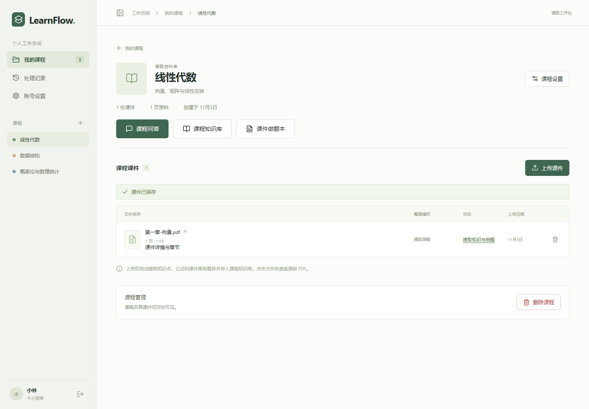
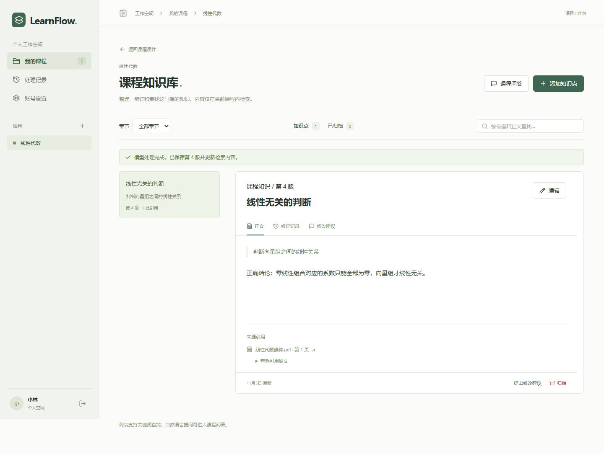

<div align="center">

# LearnFlow

[](#功能)
[](#功能)
[](#功能)
[](#分支问答)
[](#功能)

[](https://github.com/shuimqy/LearnFlow/actions/workflows/ci.yml)
[](#快速开始)
[](.python-version)
[](https://docs.astral.sh/uv/)

[功能](#功能) · [快速开始](#快速开始) · [运行模式](#运行模式) · [模型设置](#模型设置) · [文档](#文档)

</div>

LearnFlow 是一个 Agent 与后端开发相结合的实践项目，旨在解决大学生使用网页端对话模型学习时遇到的不便：课件需要反复上传，知识与对话难以按课程整理，针对某个细节的追问容易打断主线，习题也难以集中保存和打印。项目围绕这些具体需求，探索课件管理、知识检索、分支问答与做题本的实现。欢迎通过 [Issue](https://github.com/shuimqy/LearnFlow/issues) 分享使用体验、提出建议，或通过 Pull Request 参与开发。

LearnFlow 将课程课件、知识库、问答记录和做题本按课程组织。支持免登录的单机模式，也支持按账号隔离的多用户模式。



<p align="center"><sub>实际界面</sub></p>

## 功能

| 功能       | 当前支持                                                                             |
| ---------- | ------------------------------------------------------------------------------------ |
| 课件管理   | 按课程上传 PDF、查看原文件、跟踪处理进度、重试失败任务                               |
| 知识提取   | 逐页识别知识点、公式、例题和习题，保留原文与页码引用                                 |
| 知识修订   | Markdown 与 LaTeX 渲染、修订历史、归档与恢复；模型处理修改建议并返回意见和执行结果   |
| 课程问答   | 按需检索课程知识、查看引用、发送图片，保存多轮对话记录                               |
| 分支问答   | 从某条回答或选中文字发起独立追问，选择继承的上下文，在分支中继续讨论并随时返回主对话 |
| 原题做题本 | 合并同一课程的多个课件选题，按章节或页码限定范围，自动整理与去重，编辑后导出 A4 PDF  |
| 模型配置   | 自定义 LLM 与 Embedding，测试连接；更换向量模型时先建立新索引，完成后切换            |

### 分支问答

阅读回答时，可以点击下方的 **分支提问**，也可以选中某个定义、公式或推导步骤，点击 **针对选中内容提问**。分支在右侧面板打开，可连续追问、查看引用，关闭后仍可从原回答下重新打开。

创建分支时可选择上下文范围：**围绕当前回答**、**包含更多前文**，或 **仅选中片段和原问题**。分支沿用创建时的上下文，后续讨论单独保存，主对话的新消息不会自动带入已有分支。当前支持从主对话创建一级分支。

<details>
<summary>查看知识库界面</summary>



知识正文与原文引用分别保存，修订会同步更新检索内容。

</details>

**尚未实现**：AI 新题生成、跨页题干自动合并、知识笔记 PDF 导出、分支总结回写与合并。做题本当前整理的是课件原题。后续计划见 [todo.md](todo.md)。

## 快速开始

支持 **Windows**，按以下步骤从源码启动。

### 1. 准备环境

| 工具                                                          | 要求                                         |
| ------------------------------------------------------------- | -------------------------------------------- |
| [Node.js](https://nodejs.org/)                                | 20.9 及以上，推荐 22；包含 npm               |
| [uv](https://docs.astral.sh/uv/getting-started/installation/) | 管理 Python 环境和依赖，项目使用 Python 3.13 |
| Microsoft Edge                                                | 用于本机 PDF 导出和浏览器测试                |

首次启动需要联网下载依赖及数据库运行文件。Python 3.13 可由 uv 自动准备。

### 2. 获取项目并启动

```powershell
git clone https://github.com/shuimqy/LearnFlow.git
cd LearnFlow
.\start-personal.bat
```

也可以下载仓库源码 ZIP，解压后双击 `start-personal.bat`。

首次启动会安装依赖并初始化 PostgreSQL + pgvector 和 Redis，就绪后自动打开 <http://127.0.0.1:3000>。
请保持启动窗口打开；停止时双击 `stop.bat`。

### 3. 配置模型并上传课件

进入侧栏 **模型设置**，分别填写 LLM 和 Embedding 的接口地址、模型名称与 API Key，并测试连接。
创建课程后上传 PDF，识别结果会直接存入课程知识库；随后可在课程内提问或整理原题做题本。

多用户模式下，先注册或登录，再进入侧栏 **账号设置** 配置模型。模型能力要求见下方 [模型设置](#模型设置)。

## 运行模式

|          | 单机模式             | 多用户模式                             |
| -------- | -------------------- | -------------------------------------- |
| 启动入口 | `start-personal.bat` | `start-multiuser.bat`                  |
| 进入方式 | 免注册、免登录       | 注册或登录                             |
| 数据归属 | 固定的本地工作空间   | 按账号隔离                             |
| 模型设置 | 本机工作空间共用     | 每个账号单独配置                       |
| 使用范围 | 仅允许本机访问       | 保留账号认证；启动脚本默认也只监听本机 |

**切换方式：先运行 `stop.bat`，再运行另一种模式的启动脚本。** 切换不会删除数据，已有账号的课程不会自动导入单机空间。

普通 `start.bat` 读取 `.env` 中的默认模式，未设置时使用多用户模式：

```dotenv
APP_MODE=multiuser
```

改为 `APP_MODE=personal` 后重启，即可让 `start.bat` 默认进入单机模式。
`start-personal.bat` 和 `start-multiuser.bat` 直接指定本次运行的模式，优先于 `.env` 配置。

## 模型设置

LLM 用于课件识别、问答和修改建议处理；Embedding 将知识文本与问题转换成向量，供本地检索使用。每个工作空间或账号下的课程共用模型配置。

| 接口类型        | LLM | Embedding |
| --------------- | :-: | :-------: |
| 阿里云百炼      |  ✓  |     ✓     |
| 硅基流动        |  ✓  |     ✓     |
| DeepSeek        |  ✓  |     —     |
| OpenAI 兼容接口 |  ✓  |     ✓     |

- **识别 PDF 与聊天图片**：选择支持视觉的 LLM，并启用图片能力。
- **向量检索**：知识索引和问题使用一致的 Embedding 配置；向量维度需与模型实际输出一致。
- **更换 Embedding**：先生成新索引，全部完成后切换，期间保留当前模型和索引。
- **测试连接**：只发送固定样本，不读取用户课件；模型服务可能产生调用费用。

系统默认配置放在本机 `.env`，工作空间或账号的自定义配置从页面保存。详细字段和适配说明见 [账号设置](docs/account-settings.md) 与 [模型配置](docs/models.md)。

## 数据存储

课件原文、知识正文、向量和问答记录保存在本机文件系统及 PostgreSQL 中，向量检索由本地 pgvector 完成。
调用云端模型时，待识别的页面图片、相关知识文本或问题会发送到所配置的模型服务；数据发送范围取决于使用的功能。

| 位置                          | 内容                                              |
| ----------------------------- | ------------------------------------------------- |
| `storage/`                    | 上传的原始课件                                    |
| `.local/postgres/data/`       | 项目本地 PostgreSQL 数据                          |
| `.env`                        | 本机运行配置和系统默认模型密钥                    |
| `.local/model-encryption.key` | 自定义 API Key 的加密主密钥，也可通过环境变量提供 |
| `.local/logs/`                | 启动与服务日志                                    |

自定义 API Key 加密保存在数据库中。备份数据库时应同时备份课件和加密主密钥，具体见 [凭据保存与备份](docs/account-settings.md)。

## 开发

| 部分       | 技术                                  |
| ---------- | ------------------------------------- |
| 前端       | Next.js App Router、React、TypeScript |
| 正文与公式 | React Markdown、KaTeX                 |
| 后端       | FastAPI、SQLAlchemy、Alembic          |
| 数据与检索 | PostgreSQL、pgvector                  |
| 后台任务   | Redis、RQ SpawnWorker，支持 Windows   |
| 问答编排   | LangGraph、PostgreSQL checkpointer    |
| PDF        | PyMuPDF、Playwright                   |
| 依赖管理   | uv workspace、npm lockfile            |

<details>
<summary>仓库结构</summary>

```text
LearnFlow/
├── backend/
│   ├── app/
│   │   ├── api/          # 接口与归属校验
│   │   ├── core/         # 配置、认证、单机身份与凭据
│   │   ├── models/       # SQLAlchemy 模型
│   │   ├── schemas/      # 请求与响应结构
│   │   ├── services/     # 提取、检索、模型调用和做题本
│   │   ├── workers/      # RQ 执行器
│   │   └── cli/          # 数据库、队列与诊断命令
│   ├── alembic/          # 数据库迁移
│   └── tests/
├── frontend/
│   ├── src/
│   │   ├── app/          # 路由与布局
│   │   ├── features/     # 业务界面、状态、类型和样式
│   │   ├── components/   # 公共组件
│   │   └── lib/          # 通用工具
│   ├── scripts/          # 本机 PDF 排版
│   └── tests/            # 浏览器测试
├── scripts/              # 启动与服务监护
├── docs/                 # 架构与功能文档
├── .github/workflows/    # Windows CI
├── pyproject.toml        # uv workspace、Ruff 与 pytest
├── uv.lock
├── start.bat             # 按配置启动
├── start-personal.bat    # 单机模式
├── start-multiuser.bat   # 多用户模式
└── stop.bat
```

目录职责和模块边界见 [架构说明](docs/architecture.md)。

</details>

<details>
<summary>检查与测试命令</summary>

在仓库根目录执行：

```powershell
uv run --locked --all-packages ruff check backend scripts
uv run --locked --all-packages ruff format --check backend scripts
uv run --locked --all-packages pytest -q
node --test scripts/service-host.test.mjs
npm.cmd --prefix frontend run format:check
npm.cmd --prefix frontend run build
npm.cmd --prefix frontend run typecheck
npm.cmd --prefix frontend run test:e2e
npm.cmd --prefix frontend run test:e2e:personal
```

后端测试需要 PostgreSQL + pgvector，`TEST_DATABASE_URL` 必须指向库名以 `_test` 结尾的独立测试库，每个用例使用独立 schema。
两种模式的浏览器测试使用独立数据库和 3100、8001 端口，需依次执行。模型测试使用固定响应，不需要真实 API Key。
GitHub Actions 在 Windows 上运行自动检查。

</details>

手动启动、Docker 数据库、数据库维护与配置说明见 [本地开发](docs/development.md)。
后端接口文档位于 <http://127.0.0.1:8000/docs>，前后端日志位于 `.local/logs/`。

## 文档

| 文档                                 | 内容                              |
| ------------------------------------ | --------------------------------- |
| [本地开发](docs/development.md)      | 环境配置、启动方式与数据库维护    |
| [项目架构](docs/architecture.md)     | 目录职责与前后端边界              |
| [知识库](docs/knowledge-base.md)     | 数据隔离、修订与检索同步          |
| [课件提取](docs/extraction.md)       | 逐页识别、公式、例题与原题提取    |
| [修改建议](docs/proposal-review.md)  | 模型审查、执行结果与版本保护      |
| [课程问答](docs/chat.md)             | 按需检索、图片、引用与分支        |
| [做题本](docs/workbooks.md)          | 多课件选题、章节、裁片与 PDF 导出 |
| [模型配置](docs/models.md)           | 模型适配、连接测试与诊断          |
| [账号设置](docs/account-settings.md) | 模型字段、索引切换与密钥备份      |

## 许可证

本仓库尚未声明开源许可证。
